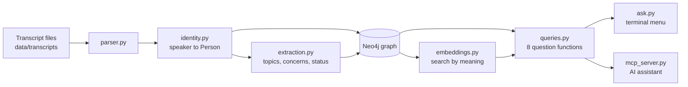
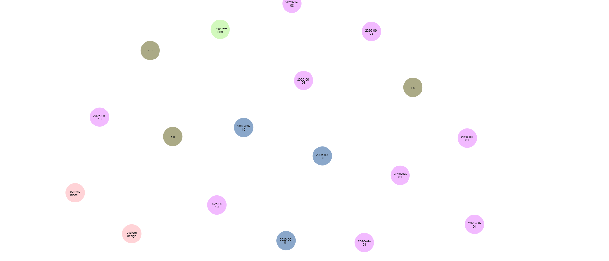
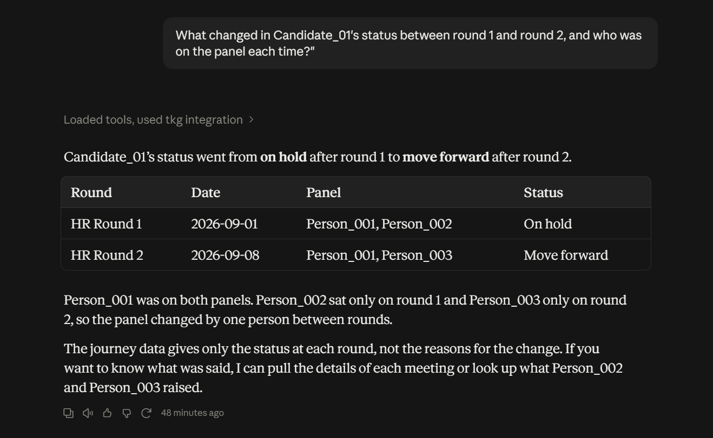

# Temporal Knowledge Graph over Meeting Transcripts
Turns meeting transcripts into a searchable knowledge graph with time tracking.
## Demo
Run: pip install networkx, then python demo.py

This prototype uses sample transcripts, keyword-based extraction and in-memory graph (NetworkX). It shows candidate journeys across rounds, status changes with time windows, and cross-department concerns.

## Next steps
- Claude-based fact extraction
- Neo4j storage
- Speaker matching across meetings
- MCP server for AI assistants

# Temporal Knowledge Graph over Meeting Transcripts

Turns meeting transcripts into a time-aware knowledge graph, so you can ask
questions like *"how did this candidate's status change between rounds?"* or
*"which teams raised the same concern?"* and get answers that always point back
to the meeting and date they came from.

> All data in this repository is made up and anonymised (people appear only as
> `Person_001`, `Candidate_01`, and so on).

## What it does

- Reads transcripts (header + speaker lines) and links each speaker to a stable `Person`
- Extracts topics, concerns and status statements from every line
- Stores everything in a Neo4j graph, with dates on every event
- Keeps status history as time windows (`valid_from` / `valid_to`) and never deletes old facts
- Answers a fixed set of 8 questions, each returning the meeting and date as evidence
- Offers those questions to an AI assistant through an MCP server, or through a terminal menu

## How it works






## The 8 questions

| Function | Answers |
|---|---|
| `search_topics` | Lines closest in meaning to a question |
| `get_person_timeline` | Everything one person said or flagged, across meetings |
| `get_candidate_journey` | Every round for a candidate, with panel and status at that time |
| `compare_meetings` | What changed between two meetings |
| `get_meeting` | Who was there and what was said |
| `find_cross_group_concerns` | Who raised a concern, in which department, when |
| `get_group_activity` | A department's meetings in a date range |
| `resolve_speaker` | Which person a speaker label is, or "needs human check" |

## Project structure

```
data/transcripts/   sample transcripts (made up)
prototype/          first simple demo (kept for reference)
src/tkg/            models, parser, identity, extraction, graph, enrich,
                    series, queries, embeddings, mcp_server, ask
tests/              tests built from the example questions
run_mcp.py          starts the MCP server
```

## Run it yourself

You need Python 3.11 or newer and [Neo4j Desktop](https://neo4j.com/download/) (free for development).

1. **Get the code and set up Python**
```
   git clone https://github.com/deepanshisharma21/Temporal-Knowledge-Graph.git
   cd Temporal-Knowledge-Graph
   python -m venv venv
   venv\Scripts\activate
   pip install -r requirements.txt
```
2. **Create a database:** in Neo4j Desktop, create a local instance called `tkg`, set a
   password, and click Start until it shows RUNNING. Neo4j must be started again each
   time you restart your computer.
3. **Add your settings:** copy `.env.example` to `.env` and put your password in it.
4. **Load the data (in this order):**
```
   python -m src.tkg.graph
   python -m src.tkg.enrich
   python -m src.tkg.series
   python -m src.tkg.embeddings
```
   Running them again is safe (no duplicates). The first embeddings run downloads a
   small language model (about 90 MB).
5. **Ask questions:**
```
   python -m src.tkg.ask
```
6. **Run the tests:**
```
   python -m pytest -v
```

### Optional: use it from Claude Desktop

Add this to your Claude Desktop config file (use your own full paths), then fully quit
and reopen the app:

```json
"mcpServers": {
  "tkg": {
    "command": "C:\\path\\to\\project\\venv\\Scripts\\python.exe",
    "args": ["C:\\path\\to\\project\\run_mcp.py"]
  }
}
```

## Limits (what this version does not do)

- **Extraction is keyword-based.** It knows only the topics and cue words listed in
  `extraction.py`, so paraphrases are missed. It returns a fixed, validated format, so a
  Claude-based extractor can replace it without changing the rest.
- **Speakers come from each transcript's `PANEL:` line.** Matching speakers across
  meetings by voice or writing style is not built; unclear cases are flagged for a human.
- **Meeting series is guessed from the meeting name** (`HR_Round1`, `HR_Round2` become
  one series). Real data may need a different rule.
- **Search by meaning ranks by topic, not tone.** "Communication was clearer" can match a
  question about communication problems, which is why concerns are read from graph
  links, not from search scores.
- **Small scale.** Similarity is calculated in Python, not in a Neo4j vector index.
- **Sample data only.** No real HR data is included or should be added without
  anonymisation and approval.
- **The MCP server is pinned to `mcp<2`**, because the newer major version renamed parts
  of the API.

## Future work

- Claude-based extraction with validated output
- Embedding-based speaker matching for transcripts without a `PANEL:` line
- Neo4j vector index for larger collections
- Anonymisation step for real transcripts
- Moving the MCP server to the newer `mcp` 2.x API

## Built from

A high-level design document covering the entities, relationships, time model and
question list. Each module in `src/tkg/` maps to one section of that design.